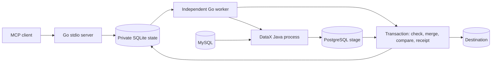

# Execution contract

## Responsibilities

No row payload travels through MCP or the Go controller. DataX handles JDBC reads and writes. Go executes destination-side SQL and handles metadata only. Keeping Java in a separate process isolates its heap and lifecycle; Go is chosen for a small deployable controller, not because Python would inherently be unable to scale.

## Durable boundary

A logical run fixes a profile and `(lower, upper]`. Its partitions are sequential, with at most 10,000 per run. One unfinished run per profile is allowed. The profile name is immutable; register a new profile for a new dataset, SQL, key, target, or mapping.

| Interruption | Next action |
| --- | --- |
| Before staging completes | Discard/ignore that attempt and reload the unfinished partition |
| During publication transaction | PostgreSQL rolls back; retry unfinished partition |
| Commit succeeds, local checkpoint missing | Read destination receipt and finish local checkpoint |
| MCP client exits | Worker is independent and continues |
| Worker exits | Supervisor restarts it; OS lock prevents a second worker for the same state |
| User pauses | In-flight partition may finish; no next partition is scheduled |
| Transfer fails | Run parks as failed; fix cause and explicitly resume |

Separate controllers targeting the same table take a PostgreSQL advisory lock. Other applications do not honor that lock: use a dedicated target. Stage tables are unique per attempt. A SIGKILL can leave an orphan Java process and staging table; it cannot publish into the final table. An operator should stop orphan processes and drop only their identified stage tables after confirming no worker owns them. Graceful worker termination kills the active Java process group.

## Integrity boundaries

- DataX dirty-record tolerance is zero. Its PostgreSQL writer is insert-only; it never writes directly into the final table.
- A partition's unique, non-NULL keys must be inside its range. The destination requires an integer primary/unique key. Unsupported mappings fail instead of advancing a checkpoint.
- All selected columns are compared in PostgreSQL after merging. This comparison cannot detect a value already changed by the source JDBC reader or a SQL projection that omitted source rows.
- Fixed ID bounds are not an MVCC snapshot. Concurrent changes, late commits, and deletes require application-specific reconciliation. Independent tables do not share a snapshot.
- Built-in limits are one DataX channel, 1 MiB/s channel/job rate, batches of 500, Java heap up to 512 MiB, and a profile timeout (default 120 seconds). An ID range can still contain oversized rows; pilot with representative sizes and inspect source query plans. Example MySQL SQL sets a 5-second execution limit; read-only credentials remain essential.
- The controller does not infer schemas, discover the source upper bound, schedule periodic runs, manage SSH tunnels, or classify the data. Those are deployment/domain concerns.

## Type fidelity

The tested projection uses BIGINT keys, BLOB→bytea, text→text, and explicit `CAST(... AS CHAR)` for DATETIME(6) and DECIMAL. Native timestamp/decimal, JSON, timezone conversion, unsigned values above int64, binary collations and other plugins are not validated. PostgreSQL text cannot contain NUL; arbitrary original content should use bytea. Reader outputs must match target columns in order.

## Operations and secrets

Run the MCP server and worker as the same trusted OS user. A state directory is private (0700; SQLite 0600). DataX jobs and logs use private attempt directories. Resolved job files are removed on normal success/failure; abrupt machine/process loss can leave them, so protect disk and remove abandoned attempt files after stopping their processes. Logs may contain credentials or row values and must never be sent to MCP clients or attached to public issues unredacted.

Provide secrets only through worker environment references. Do not change an environment reference to point to a different source or target after a run starts: profiles/checkpoints identify one logical dataset, not a newly rebound endpoint. Credential rotation for the same endpoint is allowed. This version does not automatically detect endpoint rebinding.

Back up SQLite state and destination metadata together at a quiescent boundary, with the worker stopped and no publication in flight. Never restore a newer local checkpoint against an older destination backup: the local state could skip missing data. Keep destination receipts for as long as corresponding runs/checkpoints exist. There is no automatic state/receipt garbage collector in v0.1. Restore testing and retention are operator responsibilities.

Only trusted clients may use `sync_register`: native SQL/JDBC options are approved configuration, not untrusted input. Tool descriptions and password-placeholder checks are not an authorization system. Do not expose this stdio interface as a public network service.
